# WaferSense

End-to-end anomaly detection for semiconductor wafer maps: defect pattern
recognition, discovery of unseen defect types, lot-level tool excursion
alerts, and an LLM agent that proposes root-cause hypotheses.

## Dataset
[WM-811K](https://www.kaggle.com/datasets/qingyi/wm811k-wafer-map) –
811,457 real wafer maps from semiconductor fabs (Wu et al., IEEE TSM 2015).

## Project Log
Steps are documented here in chronological order.

### Step 0 – Project setup
Repository structure, configuration and conventions.

### Step 1 – Data loading (`src/data/load.py`)
Raw pickle (2.1 GB, saved with old pandas) converted to a flat parquet cache (178 MB).
- 811,457 wafers from 46,293 lots
- 172,950 labeled (21%): 147,431 `none` + 25,519 defects in 8 patterns
- Highly imbalanced: Edge-Ring 9,680 vs Near-full 149

**Why parquet:** the pickle is slow, large and can execute code when loaded.
It is read once; all later steps load the parquet (12x smaller, columnar, fast).

**Transformations:**
- **Compatibility:** module paths from old pandas are aliased to their new location
  (fallback only, used if loading fails).
- **Labels unwrapped:** `[['Scratch']]` -> `'Scratch'`, `[]` -> `None`.
  Note the difference: `none` = inspected, no defect; `None` = never labeled.
  Unlabeled wafers feed self-supervised learning; `none` wafers are normal examples.
- **Columns renamed and typed:**

  | Original | New | Purpose |
  |---|---|---|
  | `lotName` | `lot_name` | Lot-based train/test split |
  | `waferIndex` | `wafer_index` (int) | Position of the wafer within its lot |
  | `dieSize` | `die_size` | Number of dies on the wafer (verified: equals the die count on the map); used for yield impact |
  | `trianTestLabel` | `orig_split` | Original split (typo in source); not used, since it is not lot-based |
  | – | `wafer_id` | Unique wafer identifier |

- **Wafer maps:** values are 0 = outside wafer, 1 = normal die, 2 = defective die.
  Maps vary in shape (e.g. 26x26, 52x53), so each is stored flattened (`map_flat`,
  `uint8`) with its `map_h` / `map_w`; `map_from_row()` restores the 2D map.

### Step 2 – EDA (`src/data/eda.py`, `src/data/eda_lots.py`)
Numbers in `results/metrics/eda_summary.json`.

A **lot** is a batch of wafers (up to 25) that move through the fab together and are
processed by the same tools, so a tool problem tends to hit the whole lot.

**1. Only 21% of wafers are labeled** (172,950 of 811,457).
Decision: use the unlabeled 79% for self-supervised pretraining.

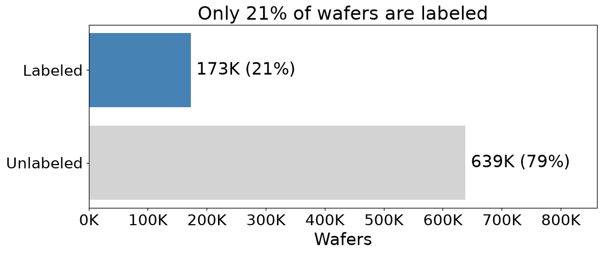

**2. Strong class imbalance:** O.K. 147,431 vs Near-full 149 (~1000x); among defects,
Edge-Ring 9,680 vs Near-full 149 (65x).
Decision: F1 macro as primary metric, class weighting.

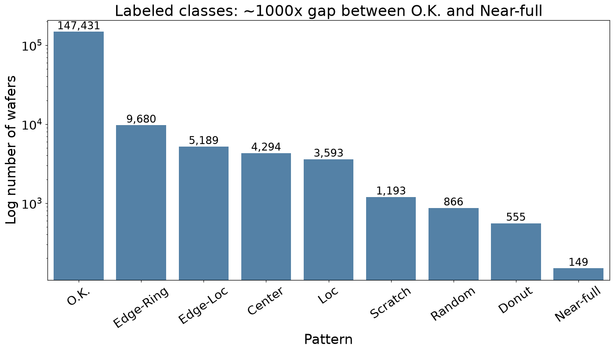

**3. Each pattern has a distinct look.** Three typical wafers per class (closest to the
class median defect share, not hand-picked). `none` is shown as **O.K.** in all figures.
Scratches are thin and often faint, making Scratch visually the hardest class.
Some wafers look elliptical: the map only counts dies per row/column and draws each die
as a square, so wafers with rectangular dies appear stretched. Resizing removes this.

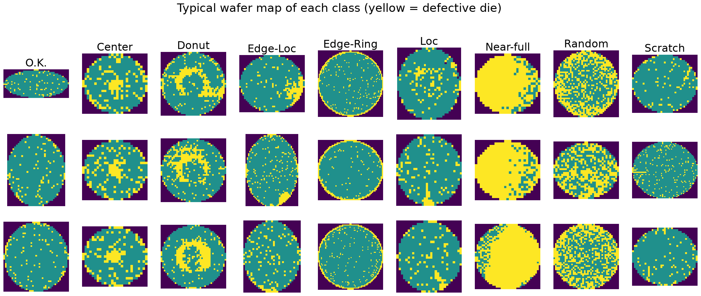

**4. Each product has its own die grid** (632 distinct shapes). Wafers are the same
physical size, but products with smaller dies fit more of them: from 515 dies (25x27
grid) to 5,633 dies (88x81 grid).
Decision: resize all maps to one fixed size before the CNN (nearest-neighbour, so the
0/1/2 values are preserved).

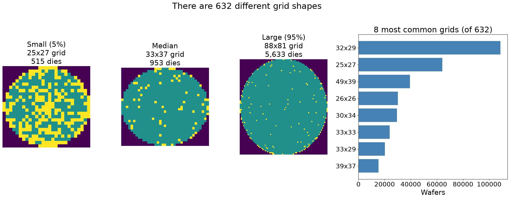

**5. Defect rate is flat across wafer position** (14–15.5%).
Decision: no global position effect; excursions must be detected per lot.

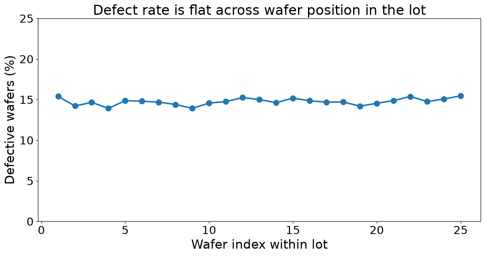

**6. A full lot is 25 wafers** (standard lot size): 47% of lots are full, and 75% of
all wafers sit in lots of 24–25. Smaller lots (peaks at 1 and 12–13 wafers) are likely
split or partially recorded lots.

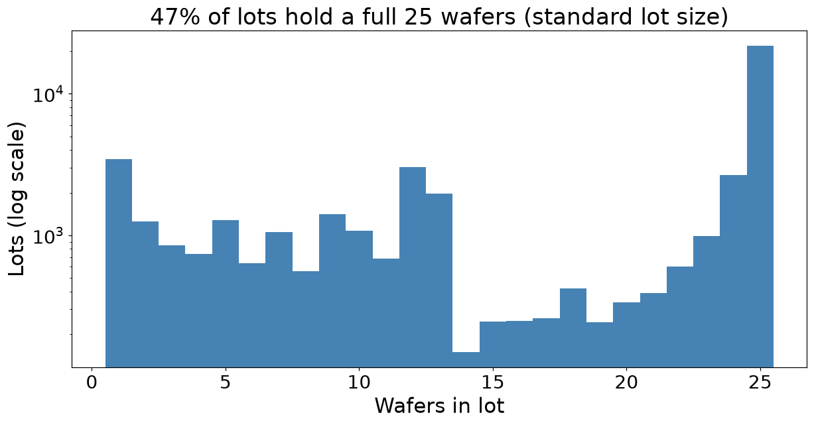

**7. Labeling was mostly done per lot (87% of lots are all-or-nothing):** 35,531 lots fully unlabeled, 4,685 fully labeled, 6,077 mixed.
Decision: a lot-based split matches how labels were produced.

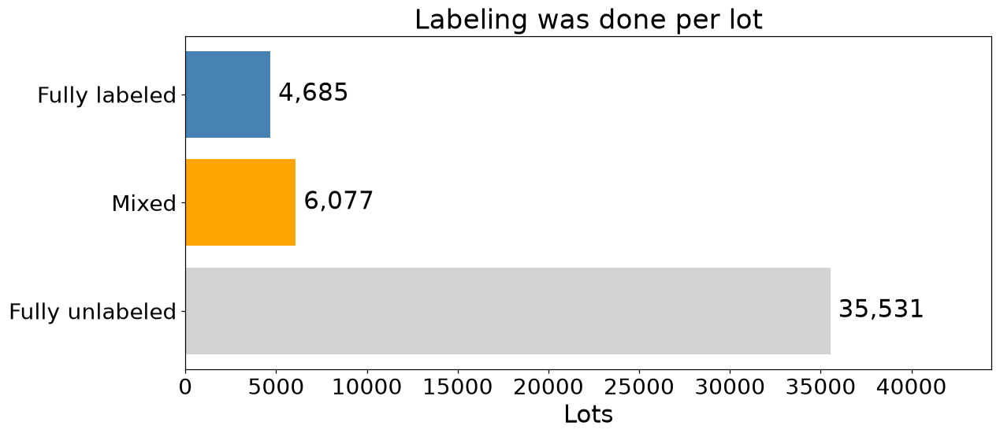

**8. Patterns repeat within a lot:** in 51.5% of lots with 2+ defective wafers,
all defects share one pattern. The peak at 0.5 is mostly lots with exactly two
defects of different types.
Decision: a random split would leak (near-identical wafers in train and test);
the lot-level excursion feature is grounded in the data.

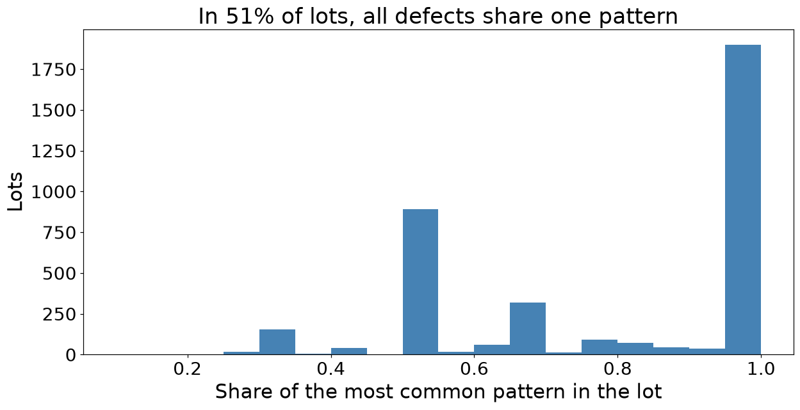
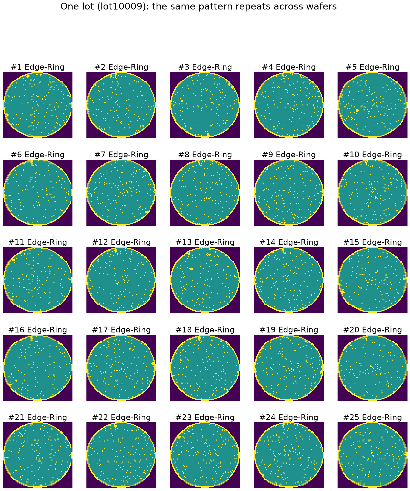

**9. Ambiguous labels:** the weakest `Center` wafers have ~1% defective dies (a tiny
central cluster), while some `none` wafers have ~33% scattered defects that look like
`Random`. WM-811K labels are known to be inconsistent; this caps achievable accuracy
and is a reason to inspect model errors visually.

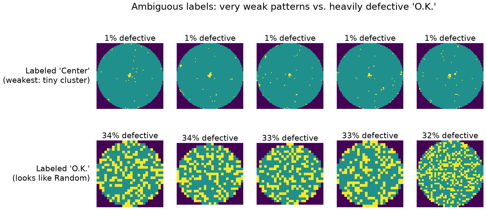

**10. Partially labeled lots are worth keeping.** The 6,077 mixed lots hold 61,182
labeled wafers and almost half of all defects (12,496 of 25,519); dropping them would
remove 83% of Center and 82% of Donut examples.

| Pattern | Fully labeled lots | Mixed lots |
|---|---|---|
| Center | 751 | 3,543 |
| Donut | 100 | 455 |
| Edge-Loc | 2,371 | 2,818 |
| Edge-Ring | 7,341 | 2,339 |
| Loc | 1,490 | 2,103 |
| Near-full | 86 | 63 |
| Random | 284 | 582 |
| Scratch | 600 | 593 |
| O.K. | 98,745 | 48,686 |

Labeling bias was checked:
- **Within a mixed lot, labeling looks random.** The labeled share is 45–47% at every
  wafer index, and labeled and unlabeled wafers have a similar share of defective dies
  (median 14% vs 12%; >20% defective: 20% vs 22%). This share is computed from the map,
  so it does not depend on the label.
- **Between lots, labeling is biased.** Mixed lots have a higher defect rate than fully
  labeled lots (20.4% vs 11.7%), and which lots got labeled depends on the product:
  heavily labeled lots are mostly small-die products (median 533 dies), while fully
  unlabeled lots are mostly large-die products (median 1,109 dies).

Decision: keep mixed lots and keep each lot whole in one split. Stratify the split by
lot type (full / mixed) as well as by class. Report test results on all lots and on
fully labeled lots only, and break results down by die size.

### EDA summary
| Finding | Decision |
|---|---|
| 79% of wafers are unlabeled | Self-supervised pretraining on unlabeled wafers |
| ~1000x class imbalance | F1 macro, class weighting |
| 632 die grid shapes | Resize to a fixed size (nearest-neighbour); keep originals for yield and display |
| No position effect within a lot | Detect excursions per lot, not globally |
| Labels and patterns cluster by lot | Lot-based split, one split for the whole project |
| Ambiguous labels | Inspect model errors visually; accuracy has a ceiling |
| Mixed lots hold half the defects | Keep them; stratify by lot type; report by die size |

### Step 3 – Lot-based split and fixed-size maps (`src/data/split.py`, `src/data/cache_maps.py`)
**One split for the whole project.** Every lot is assigned once to train, val or test
(70/15/15) and never changes; each later stage only filters from it, so every model is
compared on the same untouched test set.

- **How:** `StratifiedGroupKFold` with 20 folds (14 train / 3 val / 3 test), grouped by
  lot and stratified by lot type (full / mixed / unlabeled) and class. Unlabeled wafers
  get the split of their lot too, so test-lot wafers never reach self-supervised training.
- **Verified:** no lot appears in more than one split; every class is split close to
  70/15/15 (Random, the furthest off, is 73/14/14).
- **Result:** 567,019 / 122,092 / 122,346 wafers in 32,295 / 6,985 / 7,013 lots.
  The rarest class, Near-full, has 106 / 21 / 22 wafers.
- **Saved:** `data/processed/split.parquet` (wafer_id, lot_name, lot_type, split);
  numbers in `results/metrics/split_summary.json`.

| Split role | Used for |
|---|---|
| train | Learning |
| val | Hyperparameters, thresholds, early stopping |
| test | Opened only for the final evaluation of each stage |

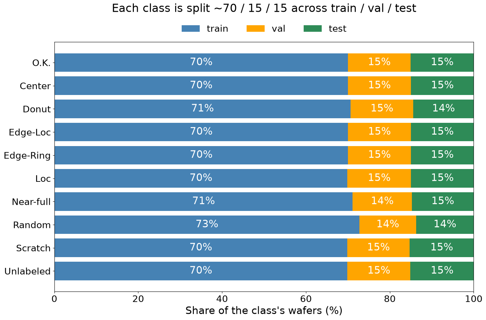

**Fixed-size maps.** CNNs need one input size, so maps are resized to 64x64 with
nearest-neighbour (values stay 0/1/2). This is a model-input cache only: the original
maps stay in `wafers.parquet` for yield, Grad-CAM and display. Labeled wafers are cached
now (`maps64_labeled.npy`, 173K x 64 x 64, 708 MB); unlabeled wafers are added before
self-supervised training (`--all`). Input size (32 / 64 / 96) is an experiment in week 2.

### Step 4 – Baseline CNN (`src/models/`)
A supervised classifier for the 9 classes, trained on Colab (T4 GPU). All numbers are on val;
test stays closed until the final model.

- **Input:** 64x64 map, one-hot encoded into 2 channels (wafer area, defects), with random
  90° rotations and flips on train.
- **Model:** 4 blocks of (Conv 3x3 → BatchNorm → ReLU) x2 → MaxPool, channels 32/64/128/256,
  global average pool, dropout 0.3, linear head. 1,175,241 parameters.
- **Training:** cross-entropy with class weights 1/√count, AdamW (lr 1e-3, weight decay 1e-4),
  batch 256, up to 30 epochs, best epoch by val F1 macro (patience 8).
- **Learning-rate schedule:** with a constant lr, val F1 swung between 0.64 and 0.78
  (best 0.777). Cosine decay to 0 over 30 epochs let the weights settle: **0.895**.

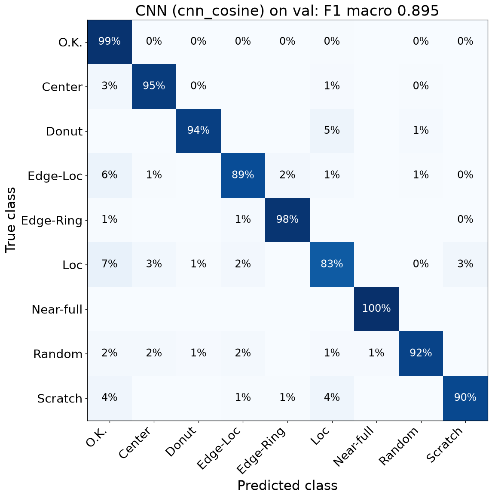

**One-change experiments.** Each run changes one setting; a repeat with another seed
measures run-to-run noise.

| Run | F1 macro | Missed defects | False alarms | Verdict |
|---|---|---|---|---|
| **Baseline** (64, weights, 2 channels) | **0.895** | **3.2%** | 1.4% | Kept |
| Same, seed 1 | 0.892 | 3.6% | 1.4% | Noise ≈ 0.003 |
| Input 32 | 0.849 | 7.9% | 1.6% | Worse on every class |
| Input 96 | 0.894 | 5.7% | 0.7% | Same F1, 2x slower |
| No class weights | 0.912 | 6.5% | 0.4% | Higher F1, 2x missed defects |
| 1 channel (0 / 0.5 / 1) | 0.886 | 6.4% | 0.8% | One-hot is better |

**Model selection rule (from here on):** the highest val F1 macro among models that miss
at most 4% of defects. F1 macro alone would have picked "no class weights", but a missed
defect costs more than a false alarm: the bad wafer moves on down the line.
